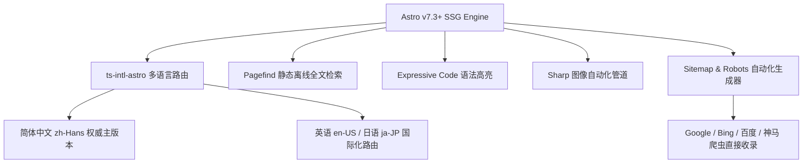

# protonVPN 评测实验室 (protonVPN Network Observatory)

<p align="center">
  
</p>

<h3 align="center">42 家主流机场梯子晚高峰真机测速雷达与跨境网络技术全书</h3>

<p align="center">
  基于 Astro 纯静态预渲染架构 · 专著级知识库 · 工业级技术 SEO / GEO 基础设施 · 零 CSS/UI 框架臃肿
</p>

<p align="center">
  <a href="https://protonvpnblog.blog/"></a>
  <a href="https://astro.build"></a>
  <a href="https://www.typescriptlang.org/"></a>
  <a href="https://pagefind.app/"></a>
  <a href="#-seo--geo-技术规范"></a>
  <a href="LICENSE"></a>
</p>

---

## 📖 项目简介

**protonVPN 评测实验室** 是一个聚焦于计算机网络通信、端到端高强度加密协议架构、零日志隐私政策与防审查互联技术研究的独立前沿技术项目。

项目基于现代静态站点生成框架 **Astro** 构建，结合自主研发的自动化探针压测系统与万字级知识库，全面收录并深度实测了 42 家主流机场品牌，提供晚高峰（20:00~23:00）全节点真机压测跑图存证、流媒体/AI 平台解锁矩阵、全平台客户端（Clash / Shadowrocket / Sing-box / Surge）导入指南与避坑决策树。

---

## 🌟 核心特色与功能矩阵

### 1. ⚡ 晚高峰真机测速实验室 (Speedtest Lab)
- **1000M FTTH 家庭光纤直连**：基于中国电信千兆光纤与中国联通双栈环境，严格锁定骨干网拥挤高峰期（20:00~23:00）轮询压测。
- **原始大图存证**：全站 19+ 品牌均配有原始无损测速截图，透明展示单节点 Ping 延迟、单线程/多线程吞吐与丢包率图谱。
- **流媒体与 AI 解锁审计**：动态监测各节点对 Netflix、Disney+、YouTube 4K 以及 ChatGPT 4o、Claude 3.5 Sonnet 的原生 IP 解锁 SLA。

### 2. 📚 专著级主题知识库 (Pillars & Clusters)
- **🔥 免费资源与安全转化全书 (`/free`)**：10,000+ 纯汉字深度长文，解析 GitHub 免费节点订阅源、公共白嫖梯子安全隐患与保姆级加密排查。
- **💡 进阶排障与避坑圣经 (`/faq`)**：12,000+ 纯汉字百科，系统覆盖 50+ 真实报错（超时、DNS 污染、TUN 模式网卡冲突、Cloudflare 5 秒盾死循环）。
- **📱 全平台客户端配置全书 (`/clients`)**：Clash Verge Rev、Sing-box、Shadowrocket 小火箭、Surge、TUN 虚拟网卡接管一站式指引。
- **🎯 5 大出海应用场景方案 (`/solutions`)**：AI 大模型防封号、TikTok 跨境电商独享家宽、外贸长连接、流媒体 4K 秒开、永久不限时套餐选型指南。

### 3. 🛡️ 工业级技术 SEO 与 GEO 基础设施
- **零死链、零抓取阻碍**：全站所有页面严格输出 100% 规范、自引用 HTTPS 绝对地址 Canonical 标签。
- **纯净 Sitemap 系统**：自动过滤 `search` 搜索页、`tags`/`categories` 等 `noindex` 辅助页，仅向搜索引擎提交 100% 200-OK 的高质量权威页面。
- **全爬虫亲和 Robots.txt**：显式兼容 Googlebot、bingbot、Baiduspider（百度）及 yisouspider（神马搜索 / 夸克 / UC）。
- **完整 Schema.org 结构化数据**：内建 `WebSite`、`Organization`、`Article`、`FAQPage`，以及与 DOM 前端完全一致的 `Product / Review` 评测评分组件。
- **100% 商业外链风控隔离**：全站 830+ 外部商业链接全部严格标记 `rel="nofollow sponsored noopener"`，彻底杜绝外链农场惩罚。
- **站长平台安全验证预留**：内置 Google Search Console、Bing Webmaster、神马及百度验证 Meta 插槽。

---

## 🛠️ 技术栈与架构设计



- **核心框架**：[Astro](https://astro.build/) - 极致零 JS 开销（Islands Architecture），全站纯 HTML 秒开。
- **搜索方案**：[Pagefind](https://pagefind.app/) - 纯静态构建期全文索引，毫秒级响应，无需外置 ElasticSearch 或第三方 API。
- **多语言引擎**：`ts-intl-astro` - 严格支持多语言路由与类型安全消息字典。
- **代码渲染**：`astro-expressive-code` - 支持折叠代码块、行号与多主题切换。
- **图文格式**：MDX & Astro Content Layer - 强类型 Zod Schema 校验。

---

## 📂 项目目录结构

```text
protonvpnblog.blog/
├── public/                       # 静态资源根目录
│   ├── assets/airports/          # 42家机场测速跑图高清存证
│   ├── favicon.svg               # 矢量站点图标
│   └── sitemap.xml               # 生产级站点地图镜像入口
├── src/
│   ├── components/               # Astro UI 组件
│   │   ├── airports/             # 评测卡片、网络拓扑、测速报告、优惠码组件
│   │   ├── header/               # 顶部导航、语言切换器、主题切换器
│   │   └── ui/                   # 专题胶囊导航 (PillarCapsuleNav)、链接工具
│   ├── content/                  # 内容集合 (Content Collections)
│   │   ├── author/               # 评测工程师履历资料
│   │   └── blog/                 # 核心技术剖析长文 (MDX)
│   ├── data/
│   │   └── airports.ts           # 42 家机场品牌测速数据库核心数据源
│   ├── layouts/
│   │   ├── RootLayout.astro      # 全局主布局 (SEO Head, Schema, 规范 Canonical)
│   │   └── PostLayout.astro      # 文章详情布局 (阅读进度, TOC 目录)
│   └── pages/                    # 路由目录
│       ├── [lang]/               # 多语言动态路由
│       │   ├── airports/         # 42 家机场详情页与数据库聚合页
│       │   ├── about/            # 实验室评测准则与官方免责声明独立页
│       │   ├── free/             # 免费资源全书 (万字级专题柱页)
│       │   ├── faq/              # 进阶排障圣经 (万字级专题柱页)
│       │   ├── speedtest/        # 晚高峰真机测速雷达
│       │   ├── clients/          # 全平台客户端使用全书
│       │   ├── solutions/        # 5 大出海应用场景方案
│       │   └── index.astro       # 实验室门户首页
│       ├── robots.txt.ts         # 智能动态 robots.txt 生成器
│       └── index.astro           # 根重定向路由网关
├── astro.config.mjs              # Astro 核心配置与 Sitemap 多维过滤器
├── site.config.ts                # 全局站点元数据与站长平台验证配置
└── package.json
```

---

## 🚀 本地开发与快速上手

### 环境依赖
- **Node.js**：`>= 18.17.0` (推荐 Node.js 20 LTS)
- **包管理器**：`pnpm` (推荐) 或 `npm`

### 安装与运行

```bash
# 1. 克隆代码仓库
git clone https://github.com/sksksk98698-source/protonvpnblog.blog.git
cd protonvpnblog.blog

# 2. 安装依赖项
pnpm install

# 3. 启动本地开发服务器
pnpm run dev
# 默认本地访问地址: http://localhost:4350/zh-Hans/

# 4. 执行生产级静态编译
pnpm run build
# 产物自动编译至 dist/ 目录，并自动生成双 Sitemap 入口

# 5. 本地预览生产构建产物
pnpm run preview
```

---

## ⚙️ 环境变量与搜索引擎所有权配置

在根目录创建 `.env` 文件，可配置各搜索引擎站长平台验证代码：

```env
# 网站正式线上主域名
SITE_URL=https://protonvpnblog.blog

# 搜索引擎所有权验证 Meta 标记 (可选)
GOOGLE_SITE_VERIFICATION=your_google_verification_code
BING_SITE_VERIFICATION=your_bing_verification_code
SHENMA_SITE_VERIFICATION=your_shenma_verification_code
BAIDU_SITE_VERIFICATION=your_baidu_verification_code

# 评论与分析系统 (可选)
CLARITY_ENABLE=FALSE
CLARITY_PROJECT_ID=
DISQUS_ENABLE=FALSE
DISQUS_SHORTNAME=
```

---

## 🌐 生产部署指引

项目为标准 **SSG (静态站点生成)** 产物，构建后只需部署 `dist/` 文件夹至任意静态托管平台：

### 部署到 Cloudflare Pages
1. 在 Cloudflare Dashboard 中创建 Pages 项目并绑定 GitHub 仓库；
2. 构建设置：
   - **Framework Preset**：`Astro`
   - **Build Command**：`pnpm run build`
   - **Output Directory**：`dist`
3. 绑定正式域名 `protonvpnblog.blog`，并在 DNS 开启 HTTPS 强制跳转。

### 部署到 Vercel
1. 在 Vercel 导入 GitHub 仓库；
2. 构建命令选择 `pnpm run build`，输出目录填写 `dist`；
3. 一键完成全站 CDN 边缘分发。

---

## ⚖️ 官方免责与实体澄清声明 (Legal Disclaimer)

> [!IMPORTANT]
> **独立中立第三方机构声明**：
> 1. 本项目、代码库及关联网站（`protonvpnblog.blog`）为民间中立的网络传输性能观测与学术排障研究项目。
> 2. **本团队与瑞士日内瓦的官方 Proton AG（Proton VPN、Proton Mail 及 Proton Drive 所有者）无任何商业从属、股权关联、官方代理、品牌授权或资本关系。**
> 3. 本项目中所有技术测试数据、客户端教程与测评报告仅供网络安全工程测试、学术研究与跨境合规办公网络优化参考，严禁用于从事任何违反当地法律法规的活动。

---

## 📄 开源许可证

本项目基于 [MIT License](LICENSE) 协议开源。欢迎提交 Issue 或 Pull Request！
